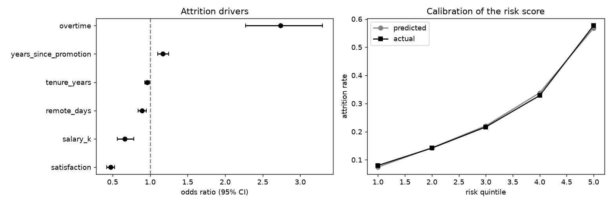

# hr-attrition-analysis

Employee attrition drivers: group rates, hypothesis tests with multiple-comparison correction, odds ratios, risk quintiles.

## Task

Find out what is associated with people leaving and how much, in a form an HR team can act on.

## Approach

- `screen_features` runs Mann-Whitney tests for numeric columns and chi-square tests for categorical ones, reports effect sizes and applies the Holm correction.
- `logistic_odds_ratios` fits a logistic regression and reports odds ratios with confidence intervals.
- `risk_groups` checks the risk score by quintile: predicted against actual attrition.

## Results



- 3,000 employees, overall attrition 26.9%.
- Highest attrition: support at 42.3%.
- Overtime multiplies the odds of leaving by 2.74; each satisfaction point multiplies them by 0.47.
- After Holm correction the significant features are: satisfaction, overtime, department, salary, remote_days, years_since_promotion.
- Attrition in the riskiest quintile is 58% against 8% in the safest.

## Run

```bash
pip install -r requirements.txt
python run.py      # generates data, runs the analysis, writes reports/
pytest             # unit tests
```

## Layout

```
src/data.py     data generation (fixed seed, no downloads)
src/core.py     analysis / model code
run.py          end-to-end script
tests/          unit tests
reports/        figures and summary.json produced by run.py
```

## Notes

The data is generated by `src/data.py` with a fixed random seed, so the numbers above are reproducible. It is synthetic: it is meant to show the method, and results on real data will differ.

Stack: pandas, scipy, statsmodels, matplotlib.
